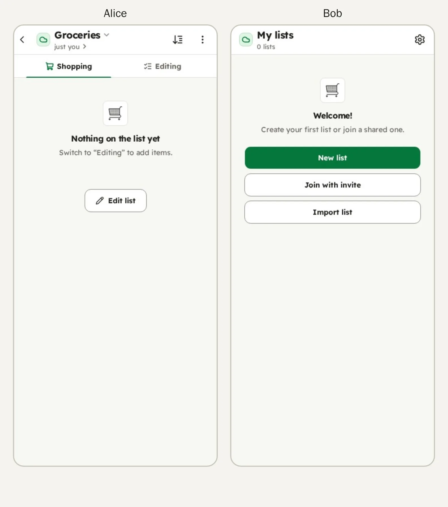
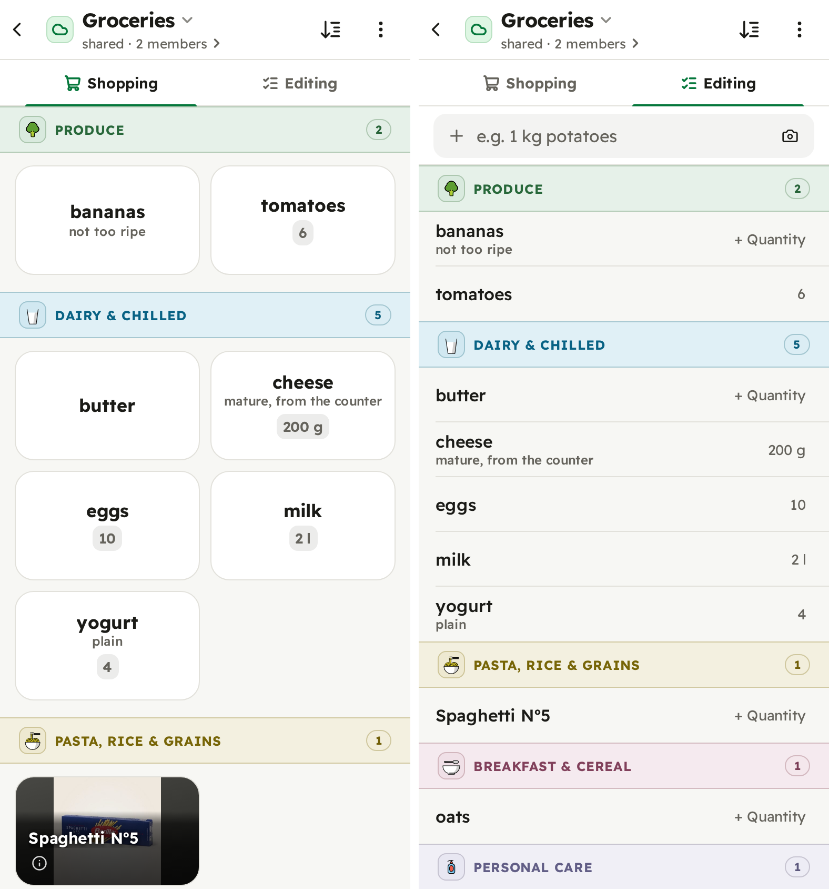
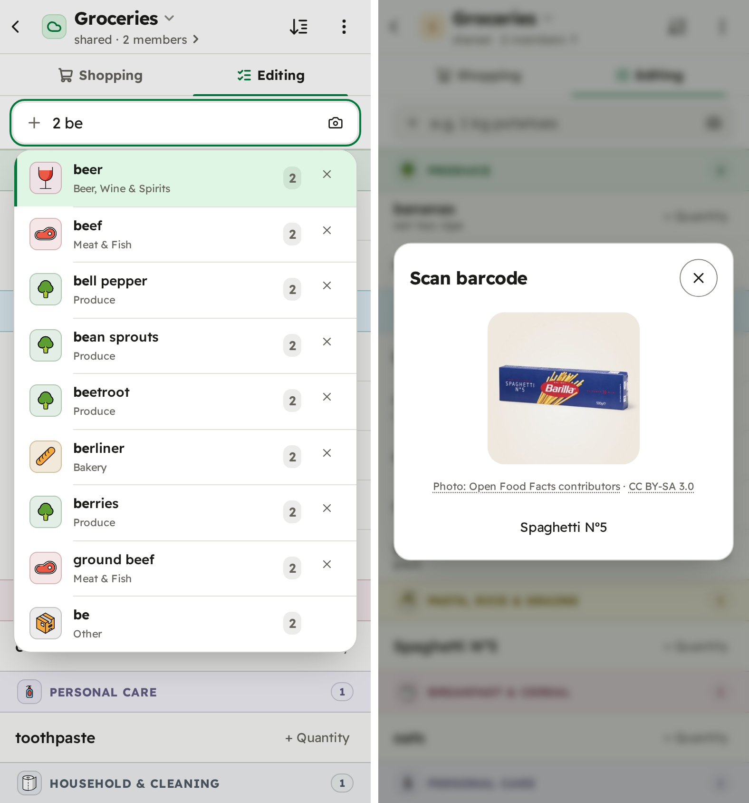
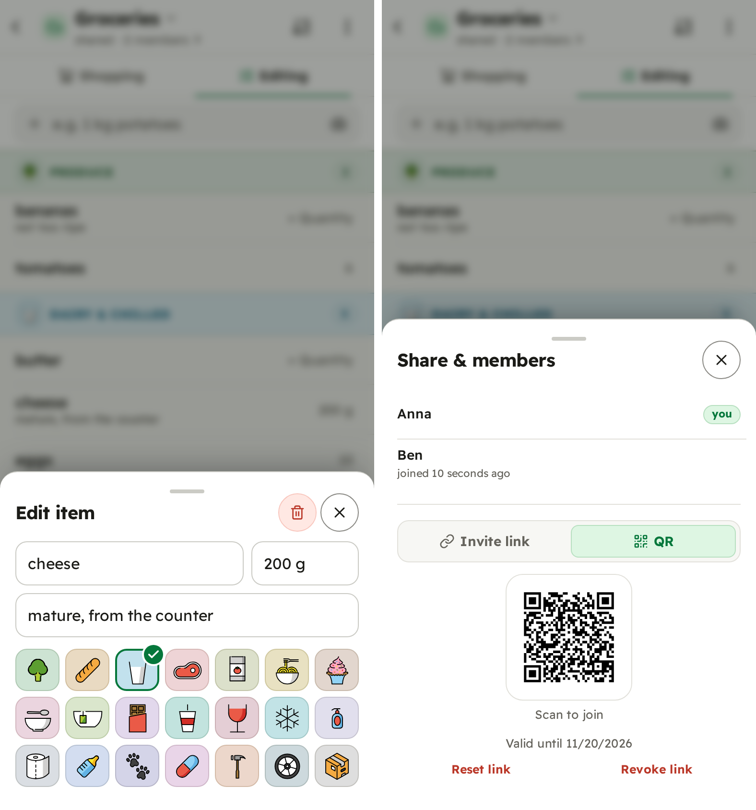
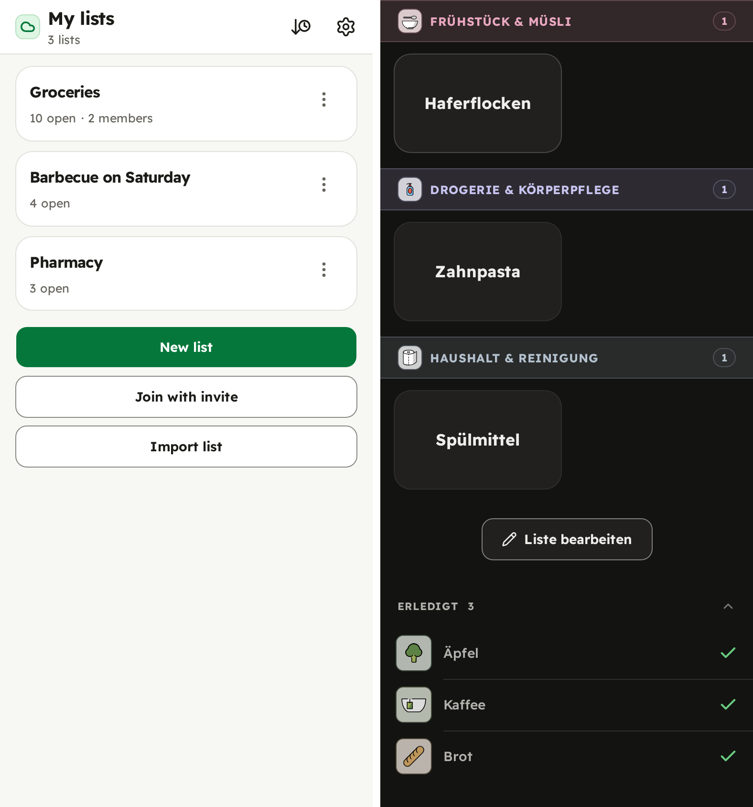
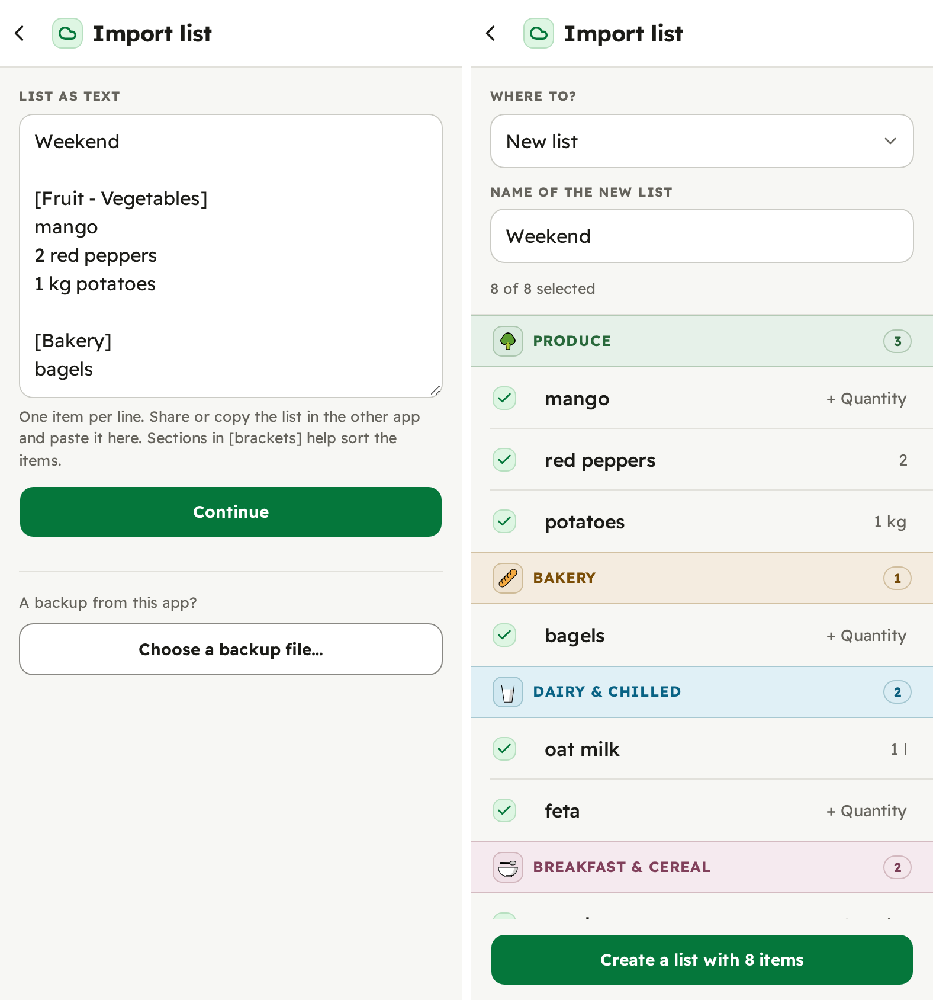

<h1 align="center"><a href="https://codeberg.org/sclermont/shoppinglist"></a> shoppinglist</h1>

<p align="center">A shared shopping list for your household, hosted by you. Syncs live, works without signal, signs in with passkeys.</p>

<div align="center">

**[Try the demo](#try-it) · [Deploy](docs/deploying.md) · [Using it](docs/using.md) · [Changelog](CHANGELOG.md)**

[](https://codeberg.org/sclermont/shoppinglist/commits/branch/main)
[](LICENSE)
[](https://codeberg.org/sclermont/-/packages/container/shoppinglist)
[](docs/using.md#getting-in)
<br>
[](https://go.dev)
[](https://pocketbase.io)
[](https://sqlite.org)
[](https://svelte.dev/docs/kit)

</div>

Everyone on a list sees changes within seconds, and it keeps working in a
supermarket with no signal. It installs to the home screen like an app and
needs no password and no email address.

One small server (a single binary or Docker image, also on a Raspberry Pi)
with a SQLite database: the image is about 50 MB and idles at about 20 MB of
memory.

<p align="center">
  
  <br><sub>Two phones, one list: share it, add to it, shop it. Every change shows up on the other phone at once, or as soon as the signal is back.</sub>
</p>

<p align="center">
  
  
  
  
  <br><sub>In the store and at home, adding by name or barcode, one item's details, sharing,
  several lists, the bought items, and the app in German and dark mode.</sub>
</p>

## What it does

- **Made for the store.** Big tiles grouped by aisle for checking off with one
  hand, and a separate view for planning. Each list has its own aisle order.
- **Quick adding.** Suggestions as you type, past items one tap away, and an
  optional barcode scanner backed by [Open Food Facts](https://world.openfoodfacts.org).
- **Shared lists, live.** Invite people with a link or QR code; everyone sees
  the others' changes as they happen.
- **Offline first.** Every change is saved on the phone first and synced when
  there is a connection. Two people changing different fields of one item at
  once both keep their change.
- **German and English.** It starts in the browser's language, and
  "Settings" → "Language" switches it.
- **No passwords, no emails.** An account is a passkey and a nickname, and
  only the people you share a list with see the nickname. Unless you sign in
  with your own provider (below), which has its own sign-in.
- **Your own SSO, if you have one.** A family or a club that already runs an
  OpenID Connect provider, such as Pocket ID, Keycloak or Authentik, can sign in
  with it ([setting it up](docs/deploy-reference.md#oidc-login)).
- **Easy to run.** One binary with the app built in, for x86 servers and ARM
  boards like the Raspberry Pi, with SQLite as its database. Run it in Docker or
  [standalone](docs/deploy-reference.md#without-docker).
- **Locked down.** The container image is distroless, with no shell, and runs
  as a non-root user. The example compose file makes its filesystem read-only
  and drops every Linux capability
  ([the hardening](docs/deploy-reference.md#the-container-is-locked-down)).

## Moving from another app

Share a list from another app to the installed app on Android, or paste it
into "Import list". Each line becomes an item in its aisle, found by its name
or by the section it had before, and “1 kg” becomes its quantity. You review
every item before anything is added and choose a new list or one you have.

This reads what Die Einkaufsliste, Mealie and Tandoor copy or share, and plain
lists from notes and chats.

<p align="center">
  
</p>

## Is it for you?

It runs in the browser of any current phone or computer
([what you need](docs/using.md#what-you-need)), and it does one thing: being
the list a household shops from. For recipes, meal plans, a pantry inventory
or prices, look at Mealie, KitchenOwl or Grocy. It
also leaves out roles and owners on a list, numeric quantities and units (“2 l”
is just text), and sign-in by email or password.

It is used every day by its author's household. Before 1.0 a minor version
can bring a breaking change; the [changelog](CHANGELOG.md) spells out each one.

## Try it

The demo runs on any machine with Docker, with no HTTPS and no passkey, and
keeps nothing once the container stops.

```sh
docker run --rm -p 127.0.0.1:8090:8090 codeberg.org/sclermont/shoppinglist:demo
```

Open **http://localhost:8090** and press "Try it": you get a guest account with
three example lists. To see sync, share a list from its ⋮ menu and open the link
in a private window.

## Run your own instance

You need Docker with Compose, HTTPS from a reverse proxy, and a domain for
passkeys, which [does not have to be public](docs/deploying.md#if-you-have-no-public-domain).
Save this as `docker-compose.yml` in a directory of its own:

```yaml
# Self-hosting guide: docs/deploying.md. Settings go in .env (.env.example
# lists them), not here.
#
#   docker compose up -d
#   docker compose logs shoppinglist   # the setup link for the first account
services:
  shoppinglist:
    # Unset, the newest release: a restart can upgrade you.
    image: codeberg.org/sclermont/shoppinglist:${SHOPPINGLIST_VERSION:-latest}
    restart: unless-stopped
    # Localhost only, for your TLS reverse proxy.
    ports:
      - "${SHOPPINGLIST_BIND:-127.0.0.1:8090}:8090"
    # All the app stores: back it up. A host directory instead:
    # docs/deploy-reference.md#bind-mounting-a-host-directory-instead-of-a-named-volume
    volumes:
      - shoppinglist_data:/pb_data
    env_file: .env
    # Locked down: docs/deploy-reference.md#the-container-is-locked-down
    read_only: true
    tmpfs:
      - /tmp
    cap_drop:
      - ALL
    security_opt:
      - no-new-privileges:true
    mem_limit: 1g
    pids_limit: 256

volumes:
  shoppinglist_data:
```

Write a `.env` beside it and start:

```sh
cat > .env <<'EOF'
# CHANGE: your bare domain (no https://, no port, no IP)
SHOPPINGLIST_RP_ID=list.example.com
SHOPPINGLIST_SIGNUP=invite
SHOPPINGLIST_TRUSTED_PROXY_HEADER=X-Forwarded-For
EOF
docker compose up -d
docker compose logs shoppinglist   # logs contain the setup link for your first account
```

Point your reverse proxy at `127.0.0.1:8090`. Create your own account through
the one-time setup link in the log; everyone else joins through a list's invite
link (⋮ → "Share & members").

This runs the newest release, so a restart can upgrade you; add
`SHOPPINGLIST_VERSION=X.Y.Z` from the
[releases page](https://codeberg.org/sclermont/shoppinglist/releases) to stay on
one. Every other setting is in [`.env.example`](.env.example), upgrades and the
admin account in [`docs/deploying.md`](docs/deploying.md), and backups in
[`docs/operating.md`](docs/operating.md#backups).

A plain binary for `linux/amd64`, `arm64` and `armv7`, zipped, is on the
[releases page](https://codeberg.org/sclermont/shoppinglist/releases).

## How it's built

- **Server:** Go on [PocketBase](https://pocketbase.io), with SQLite as the
  only database. The app's own routes handle sync, invites, passkeys
  ([go-webauthn](https://github.com/go-webauthn/webauthn)) and the barcode
  lookup; the web app is compiled into the binary.
- **App:** [SvelteKit](https://svelte.dev) with Svelte 5 as a static,
  installable web app (PWA), styled with Tailwind CSS and
  [bits-ui](https://bits-ui.com). Lists live in the browser's IndexedDB
  ([Dexie](https://dexie.org)), and a sync engine of its own sends changes
  through an outbox. Translations use [Paraglide](https://inlang.com), and
  barcodes are read on the phone with
  [zxing-wasm](https://github.com/Sec-ant/zxing-wasm).
- **Tests:** Go tests, Vitest, two app instances syncing against a real
  server, and Playwright in a real browser, with passkeys and an OpenID
  Connect provider ([Dex](https://dexidp.io)) included. [`CONTRIBUTING.md`](CONTRIBUTING.md)
  gets you from a checkout to a running app.

## Documentation

- [Using it](docs/using.md): for your household. Getting in, installing it,
  the two views, a lost phone.
- [Deploying](docs/deploying.md): **start here.** Domain, settings, reverse
  proxy, first boot, upgrades, with a [full reference](docs/deploy-reference.md)
  behind it.
- [Operating](docs/operating.md): running an instance day to day. Backups,
  maintenance.
- [Changelog](CHANGELOG.md): what each release changed.
- [Contributing](CONTRIBUTING.md): building, running and testing it yourself.
- [Security](SECURITY.md): reporting a vulnerability.

The full specification and the reasoning behind every decision live in
[`docs/internals/`](docs/internals/): long, precise and written for whoever
changes the code, coding agents included.

## License

[AGPL-3.0](LICENSE): if you run a modified version as a service for others,
offer them its source (`SHOPPINGLIST_SOURCE_URL` points the app's "Source
code (AGPL-3.0)" link at yours). Bundled third-party work (OpenMoji artwork, CC BY-SA 4.0;
the Readex Pro typeface, OFL 1.1; and every library) is listed in
[`docs/THIRD_PARTY_LICENSES.md`](docs/THIRD_PARTY_LICENSES.md). Barcode results
come from Open Food Facts (ODbL), credited in the app; so does the product
photo in the screenshots above (Open Food Facts contributors, CC BY-SA).
