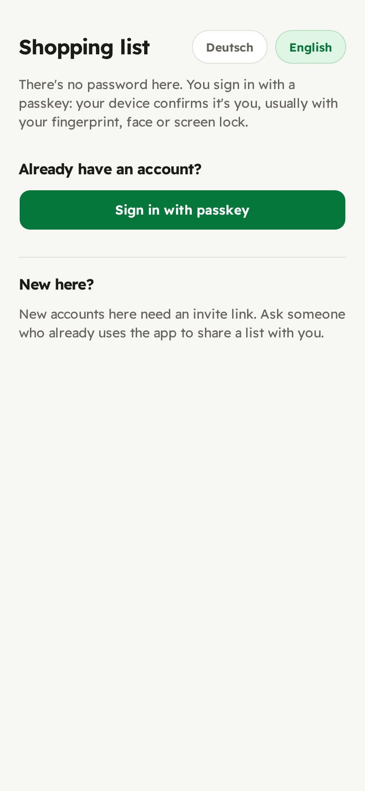
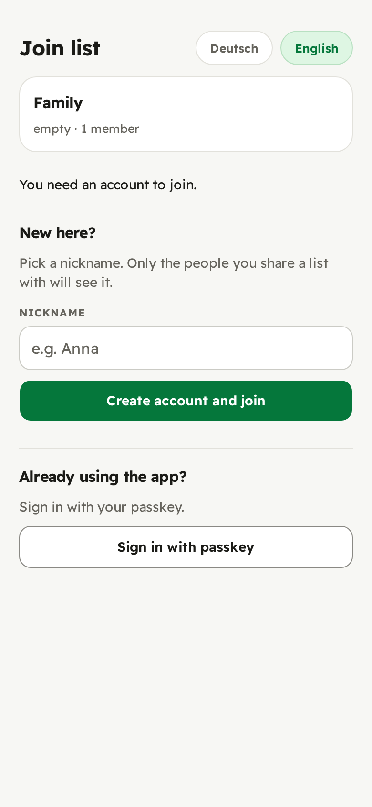
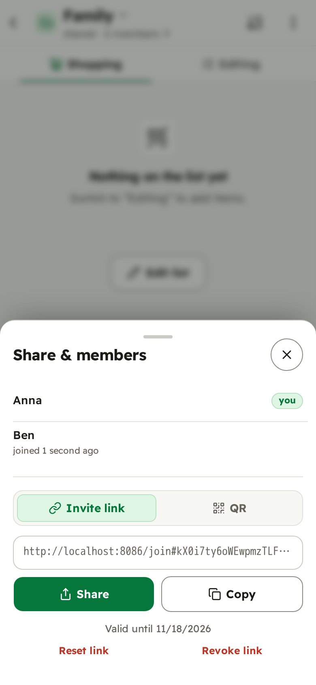
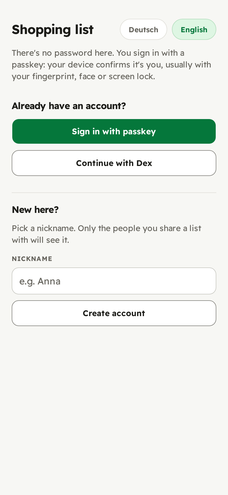
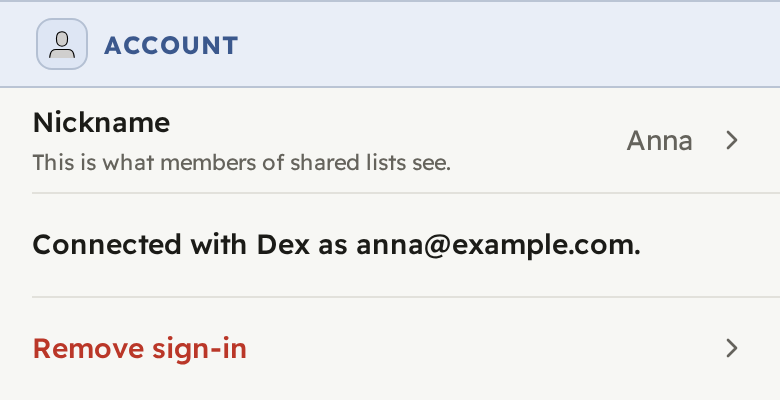
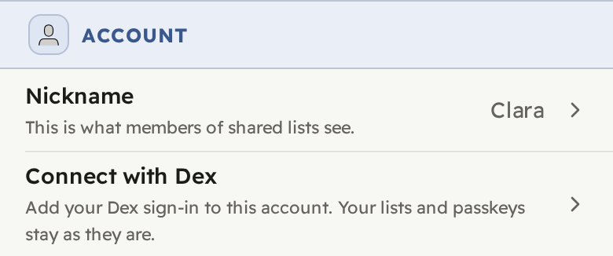

# Deployment reference

Every setting and deployment detail in full. For the short path to a running
instance, start with [`deploying.md`](deploying.md); for running it day to day
(backups, maintenance jobs), see [`operating.md`](operating.md).

**Contents:** [Environment variables](#environment-variables) ·
[Who can sign up](#restricting-who-can-sign-up) · [OIDC login](#oidc-login) ·
[Login methods](#choosing-the-login-methods) ·
[Remote administration](#turning-off-remote-administration) ·
[RP-ID and RP-ORIGIN](#getting-rp-id-and-rp-origin-right) ·
[Reverse proxy](#the-reverse-proxy-is-part-of-the-security-model) ·
[Running it](#running-it) · [First boot](#first-boot) ·
[Upgrades](#upgrades) · [Hardening notes](#hardening-notes)

## Environment variables

There is no database URL (SQLite lives in the data volume), no secret key
(PocketBase generates its own) and no port setting (the image listens on
`:8090`; remap it with Docker's `-p`).

<!-- settings table: Serve Boot (rendered from backend/internal/settings/settings.go by its test) -->
| Variable | Default | What it does |
|---|---|---|
| `SHOPPINGLIST_RP_ID` | *required with passkeys* | The bare domain the app is served on, e.g. `list.example.com`: no scheme, port or path, and not an IP. [Effectively permanent.](#getting-rp-id-and-rp-origin-right) |
| `SHOPPINGLIST_RP_ORIGIN` | `https://<RP_ID>` | The exact origin in the address bar, scheme and non-default port included. Set it only when that is not `https://` + the RP-ID. |
| `SHOPPINGLIST_SIGNUP` | `open` (`.env.example`: `invite`) | `closed` refuses new passkey accounts; `invite` admits them only through an invite link. [Details](#restricting-who-can-sign-up). |
| `SHOPPINGLIST_PASSKEYS` | `on` | `off` turns passkey login off; needs `SHOPPINGLIST_OIDC=on`. [Details](#choosing-the-login-methods). |
| `SHOPPINGLIST_OIDC` | `off` | `on` turns sign-in through your OpenID Connect provider on. [Details](#oidc-login). Unset while the connection below is set stops the start, so a configured login is not switched off by omission. |
| `SHOPPINGLIST_OIDC_*` |  | The provider connection: `SHOPPINGLIST_OIDC_CLIENT_ID`, `SHOPPINGLIST_OIDC_CLIENT_SECRET`, `SHOPPINGLIST_OIDC_ISSUER`, optional `SHOPPINGLIST_OIDC_NAME`; for a provider without discovery, `SHOPPINGLIST_OIDC_AUTH_URL`, `SHOPPINGLIST_OIDC_TOKEN_URL` and `SHOPPINGLIST_OIDC_USERINFO_URL` instead of the issuer. [Details](#oidc-login). |
| `SHOPPINGLIST_ADMIN_UI` | `on` | `off` removes the `/_/` dashboard and every superuser login over HTTP. [Details](#turning-off-remote-administration). |
| `SHOPPINGLIST_SCANNER` | `on` | `off` removes the barcode scanner and its camera permission; the server then never contacts Open Food Facts. Photos already stored keep showing. |
| `SHOPPINGLIST_MAX_ITEMS_PER_LIST` | `5000` | Most items one list holds, bought and removed ones included. Below `2000` it also caps one import. Lowering it deletes nothing. |
| `SHOPPINGLIST_MAX_LISTS_PER_ACCOUNT` | `25` | Most lists one account can be on, its own and joined ones. Joining is never refused. Lowering it removes no one. |
| `SHOPPINGLIST_SOURCE_URL` | this repository | Where the settings screen's "Source code" link points. Running a **modified** version, the AGPL-3.0 requires pointing it at your source. The barcode lookup names it to Open Food Facts too, in its User-Agent. |
| `SHOPPINGLIST_APP_URL` | `http://localhost:8090` | PocketBase's "app URL". With passkeys off, the app's origin when `SHOPPINGLIST_RP_ORIGIN` is unset. |
| `SHOPPINGLIST_TRUSTED_PROXY_HEADER` | *unset* (`.env.example`: `X-Forwarded-For`) | The header your reverse proxy puts the client IP in, usually `X-Forwarded-For`. Without it every user shares one rate limit. Unset keeps a header an earlier start stored (the log warns); clear it in the dashboard. [Details](#1-send-the-app-the-real-client-ip). |
| `SHOPPINGLIST_TRUSTED_PROXY_LEFTMOST` | `off` | `on` reads the header's leftmost value. Only for a [proxy chain](#only-if-you-run-a-proxy-chain) whose every hop overwrites the header. |
| `SQLITE_PRAGMAS` | *stock* | Only for a data directory on NFS or virtiofs. [Details](#sqlite-on-network-storage). |
<!-- settings table end -->

Every `SHOPPINGLIST_*` value is checked at boot: a typo such as
`SHOPPINGLIST_SIGNUP=false` stops the server with a message, rather than
falling back to a default. The
caps above bound how much one account can make the server store
(25 × 5,000 items by default); the rate limits only slow it down.

**Every line of `.env` reaches the app** (`env_file: .env`); a setting left
out takes its default. Settings exported in the shell or kept in a tool's own
stack variables, not in a `.env` file beside the compose file, do not. Two
`.env` variables are for Compose itself, and the app ignores them:
`SHOPPINGLIST_VERSION` (the image tag, default `latest`) and
`SHOPPINGLIST_BIND` (the published address, default `127.0.0.1:8090`).

**A misspelt name stops the start.** The server refuses to start while a
`SHOPPINGLIST_` variable is set that is none of the above, and names it: it
would otherwise do nothing, and a lockdown such as `SHOPPINGLIST_SIGNUP=closed`
written wrong would leave the instance open. A variable set to nothing is
ignored.

`.env.example` sets four values: the version and the domain, which you
change, and invite-only sign-up and the trusted-proxy header, which suit an
instance behind a reverse proxy. Everything else in it is commented out and
off or at its default.

### Restricting who can sign up

Without the setting, anyone who can reach the server can create a passkey
account; `.env.example` sets `invite`. A stranger with an account still cannot
see your lists: access is per list, through invite links.

| `SHOPPINGLIST_SIGNUP` | New passkey accounts |
|---|---|
| `open` | anyone |
| `invite` | only someone opening a list's invite link, who joins that list; the first account through a setup link printed to the log |
| `closed` | none; the auth screen stops offering "Create account" |

Under every setting, existing accounts still sign in and add passkeys, and
invite links still let people with an account join a list.

| Without a link | With a list's invite link | The list's share sheet |
|:-:|:-:|:-:|
|  |  |  |
| <sub>No "Create account", only<br>a note to ask for a link.</sub> | <sub>The list's preview, and an<br>account straight onto it.</sub> | <sub>Where the link comes from;<br>"Reset link" retires it.</sub> |

**The setup link.** With `invite` and no account yet, every boot logs:

```
shoppinglist: no accounts yet and SHOPPINGLIST_SIGNUP=invite — create the first account at https://list.example.com/#setup=… (valid until the first account exists; …)
```

Open it, create your account, then make a list and share it. It admits
exactly one account and lives only in memory: a restart prints a new one, and
none is printed once an account exists. Treat it as a secret while it is
valid.

**Invite links under `invite`.** A newcomer opening a list's invite link
("Share & members") can create an account there and is added to that list
in the same step, so everyone who came in shows up in some list's members. A
link lasts 30 days; "Reset link", "Revoke link" or any member leaving retires it.

The switch covers passkey sign-up only. With OIDC on, the provider decides who
may sign in, and a first sign-in creates the account: restrict the client at
the provider. Combined with `closed`, that makes the provider the only way in
for new people while passkey accounts keep working.

### OIDC login

Members can sign in through an OpenID Connect provider such as Keycloak,
Authentik, Pocket ID or Entra ID. Set the switch, the client, and the
provider's **issuer** (its issuer URL or its `.well-known/openid-configuration`
address):

```sh
SHOPPINGLIST_OIDC=on
SHOPPINGLIST_OIDC_CLIENT_ID=shoppinglist
SHOPPINGLIST_OIDC_CLIENT_SECRET=…
SHOPPINGLIST_OIDC_ISSUER=https://idp.example.com/realms/hh
SHOPPINGLIST_OIDC_NAME=Keycloak   # the button label; default "OIDC"
```

At the provider, create a confidential client with the redirect URI
**`<app-origin>/api/oauth2-redirect`**, exactly, no trailing slash. No logout
URL is needed, and PKCE may be on or off.

The server reads the provider's endpoints from its discovery document at every
start. If the provider is down, it uses the endpoints from its last start and
logs a warning; only a first start that never reached it refuses to boot. For
a provider without discovery, set `SHOPPINGLIST_OIDC_AUTH_URL`,
`SHOPPINGLIST_OIDC_TOKEN_URL` and `SHOPPINGLIST_OIDC_USERINFO_URL` instead of
the issuer.

`SHOPPINGLIST_OIDC=off` switches OIDC off at every boot, including a provider
added in the dashboard. Client or endpoint variables without the switch refuse
the boot.

**What users see:**

| Auth screen | Settings, OIDC account | Settings, passkey account |
|:-:|:-:|:-:|
|  |  |  |

- "Continue with ‹name›" on the auth screen. The first sign-in creates an
  account, named after the provider's name claim, username or the part of the
  email before the @. The account stores no email address, but the
  identity shown in settings is the provider's username, or the email when it
  has none.
- "Connected with ‹name› as ‹identity›" in settings, shown only to that user.
- "Link with ‹name›" in a passkey account's settings, which adds the
  provider login to that account and keeps its lists. "Remove sign-in"
  takes it off again once the account has a passkey.

Each provider identity is its own account. It is never merged into another
account by a matching email, and linking is refused when the identity already
has an account with lists or passkeys of its own.

**If sign-in fails after the provider accepted it,** the server log has a line
with `OIDC sign-in failed after the provider accepted it` and the cause.
"Failed to fetch OAuth2 token" means a wrong client secret, token endpoint or
redirect URI; "Failed to fetch OAuth2 user" a wrong userinfo endpoint.
Hand-set endpoints are the usual culprit, which the issuer setting avoids.
Behind an [egress allowlist](#an-egress-allowlist), check that it allows the
provider's hosts.

### Choosing the login methods

| Setup | Variables | Auth screen offers |
|---|---|---|
| Passkeys only (default) | nothing | passkey sign-in, and "Create account" while sign-up allows |
| Passkeys and OIDC | `SHOPPINGLIST_OIDC=on` + connection | both |
| OIDC only | `SHOPPINGLIST_PASSKEYS=off`, `SHOPPINGLIST_OIDC=on` + connection | the provider button only |

With passkeys off, `SHOPPINGLIST_RP_ID` is not needed, but
`SHOPPINGLIST_RP_ORIGIN` or `SHOPPINGLIST_APP_URL` is, and
`SHOPPINGLIST_SIGNUP` has no effect.

Switching a login off strands the accounts that have only that login, and the
boot log counts them ("WARNING 3 account(s) have no OIDC login…"). Before
turning passkeys off, have everyone link their account in settings while both
are on; before turning OIDC off, have OIDC-only accounts add a passkey.

### Turning off remote administration

`SHOPPINGLIST_ADMIN_UI=off` removes the admin surface completely: `/_/`
returns 404, and no superuser can get a token over HTTP by any route.
Administration then happens on the host, with the binary's `superuser` and
`dictionary-suggestions` commands.

Before you set it:

- PocketBase's own enrolment link (first boot) points at `/_/` and stops
  working. Create the superuser with
  [`superuser upsert`](#running-it) instead.
- Dashboard settings such as the backup schedule and rate limits become unreachable.
  Configure them first, or switch the dashboard back on briefly when you need
  it. The trusted-proxy header has its own variable and needs no dashboard.

### Getting RP-ID and RP-ORIGIN right

These two are the most common way to end up with an app that loads but cannot
register a passkey.

- **`RP_ID` is a domain, `RP_ORIGIN` a URL:** `list.example.com` vs
  `https://list.example.com`.
- **`RP_ORIGIN` must match the address bar** character for character: scheme,
  host and port. `http://` against an `https://` page rejects every passkey.
- **`RP_ID` is the host or a parent domain of it.** At
  `https://list.example.com`, both `list.example.com` and `example.com` work;
  `other.example.com` does not. Prefer the exact host unless passkeys should
  work across subdomains.
- **The domain is permanent.** Every passkey belongs to the RP-ID it was made
  under; changing it strands all of them, and everyone registers again.

Before inviting anyone, register an account at your real domain, then **reload
and sign in with the passkey**. Registration working and sign-in failing means
`RP_ORIGIN` is wrong.

## The reverse proxy is part of the security model

Passkeys need HTTPS, so the app runs behind a reverse proxy (Caddy, nginx,
Traefik) that terminates TLS. Two things follow.

### 1. Send the app the real client IP

The app rate-limits its own routes (sign-in, sign-up, invites, sync, barcode
lookups, imports and more) per client IP. By default it trusts no proxy
header, so behind a proxy every user appears as the proxy's IP and shares one
rate limit. Set this before handing out the URL:

```sh
SHOPPINGLIST_TRUSTED_PROXY_HEADER=X-Forwarded-For
```

It is applied at every boot and wins over the dashboard (`/_/` → Settings →
Application, where it can also be set by hand).

#### Only if you run a proxy chain

Behind several proxies (client → CDN → load balancer → app) the header holds
several addresses, and by default the app reads the rightmost one, which is
your own innermost proxy. `SHOPPINGLIST_TRUSTED_PROXY_LEFTMOST=on` reads the
leftmost, the real client.

> **Only if every hop overwrites the header.** If any hop appends to a
> client-supplied value, as nginx's
> `proxy_set_header X-Forwarded-For $proxy_add_x_forwarded_for` does, the
> leftmost value is whatever the caller sent, and a caller can dodge every
> rate limit. nginx's `$remote_addr` and Caddy's default both overwrite.

### 2. Do not expose the container port

Publish the port to the proxy only: `127.0.0.1:8090` (the compose default), or
an internal Docker network. A public `-p 8090:8090` serves the app, and its
admin dashboard, over plain HTTP.

### A known-good Caddy config

```caddyfile
list.example.com {
	# The one security header the app cannot send itself, since it speaks
	# plain HTTP to the proxy. The app sends all the others; do not add them.
	header Strict-Transport-Security "max-age=31536000; includeSubDomains"
	reverse_proxy 127.0.0.1:8090
}
```

Caddy provisions the certificate and sets `X-Forwarded-For` correctly. Drop
`includeSubDomains` if another subdomain is served without HTTPS. nginx and
Traefik work too, with the TLS and header lines written out.

**Do not add a Content-Security-Policy at the proxy.** The app sends its own,
and a browser applies both: a second policy can only block more, and a typical
`script-src 'self'` blanks the page.

## Running it

The recommended setup is the shipped compose file ([`deploying.md`](deploying.md)).
The equivalent `docker run`:

```sh
docker run -d --name shoppinglist --restart unless-stopped \
  -p 127.0.0.1:8090:8090 \
  -v shoppinglist_data:/pb_data \
  -e SHOPPINGLIST_RP_ID=list.example.com \
  codeberg.org/sclermont/shoppinglist:X.Y.Z
```

Pin a version rather than `:latest`, so a restart never upgrades you across a
database change.

**The volume is the whole application:** every account, passkey, list, item
and stored product photo. Back it up ([`operating.md`](operating.md#backups)).
There is no email login, so a lost volume cannot be recovered.

The image runs as an unprivileged user (uid/gid `65532`) and is distroless:
the binary, CA certificates and time zones, and no shell, so `docker exec …
sh` does not work. Run the binary's other commands by overriding the entrypoint:

```sh
docker compose run --rm --entrypoint /shoppinglist shoppinglist \
  superuser upsert you@example.com 'a-long-random-password' --dir=/pb_data
docker compose run --rm --entrypoint /shoppinglist shoppinglist --version
```

Without `--entrypoint`, the arguments are appended to the image's `serve`
command instead. `--version` prints the release and commit an image was built
from.

### Without Docker

The [releases page](https://codeberg.org/sclermont/shoppinglist/releases) has
a single self-contained binary for `linux/amd64` and `arm64`:

```sh
SHOPPINGLIST_RP_ID=list.example.com \
./shoppinglist serve --http=127.0.0.1:8090 --dir=/path/to/data
```

`--dir` plays the part of the `/pb_data` volume; everything else on this page
applies unchanged.

### Bind-mounting a host directory instead of a named volume

A named volume takes its ownership from the image and just works. A bind mount
keeps the host directory's ownership, and if uid `65532` cannot write it, the
app exits with `unable to open database file (14)`. Create the directory
before the first start (Docker would create it as `root`), then either:

- **run the container as yourself** (recommended), so the files are yours on
  the host and backups need no `sudo`:

  ```yaml
  services:
    shoppinglist:
      user: "1000:1000" # your `id -u`:`id -g`
      volumes:
        - /srv/shoppinglist/data:/pb_data
  ```

- or **give the directory to the image's user:**
  `sudo chown -R 65532:65532 /srv/shoppinglist/data`.

On SELinux hosts (Fedora, RHEL), add `:Z` to the mount.

### SQLite on network storage

SQLite's default mode here (WAL) is unsafe on network filesystems such as NFS
or virtiofs, and can corrupt the database. If the data directory sits on such
a share, switch to rollback-journal mode:

```sh
SQLITE_PRAGMAS=?_pragma=busy_timeout(10000)&_pragma=journal_mode(DELETE)&_pragma=synchronous(FULL)&_pragma=foreign_keys(ON)&_pragma=temp_store(MEMORY)&_pragma=cache_size(-32000)&_pragma=mmap_size(0)
```

Use the value as given: `busy_timeout` must come first, and `synchronous(FULL)`
is what makes the journal safe on power loss. Setting the variable also limits
the database to 16 concurrent readers. A local volume should not set it.

To switch an existing database, stop the server, back up the data directory,
and start with the variable set; SQLite converts it on start. Unsetting it
converts back.

### A public demo

The `:demo` image is the one-command demo from the README: guest accounts
with example lists, no passkeys, no OIDC and no admin dashboard, every
account deleted after 24 hours. It is made for one person on their own
machine, so it lets one address start 1,000 demos per 10 minutes. To offer it
publicly, behind the same kind of reverse proxy, set:

<!-- settings table: Demo (rendered from backend/internal/settings/settings.go by its test) -->
| Variable | Default | What it does |
|---|---|---|
| `SHOPPINGLIST_DEMO_STARTS_PER_IP` | `1000` in the image, `3` without it | How many demos one address may start per 10 minutes. Set `3` for a public demo. |
| `SHOPPINGLIST_DEMO_MAX_ACCOUNTS` | `200` | How many demo accounts may exist at once; a start beyond it is refused until old ones expire. |
<!-- settings table end -->

Set `SHOPPINGLIST_APP_URL` to the demo's address, e.g.
`https://demo.example.com`, and `SHOPPINGLIST_TRUSTED_PROXY_HEADER` to
`X-Forwarded-For`, as for a real instance.

### Health checks

The image declares a `HEALTHCHECK`, so `docker ps` shows `healthy` and
Compose's `condition: service_healthy` works. The check is the binary itself,
`shoppinglist healthcheck`, which requests `/api/health` and exits 0 on
success (`--addr host:port` if you changed the listen address):

```sh
docker compose exec shoppinglist /shoppinglist healthcheck
```

## First boot

1. **Check it came up.** A container that exits names the reason in
   `docker compose logs shoppinglist`, usually the RP-ID or a mistyped value.
2. **Create the first account.** Under `SHOPPINGLIST_SIGNUP=invite`, open the
   setup link from the log (`create the first account at https://…/#setup=…`).
   It admits one account and is gone once that exists. Under `open`, just
   create one.
3. **Create the superuser** with `superuser upsert` ([above](#running-it)).
   Alternatively, with the dashboard on, PocketBase logs a one-time
   `/_/#/pbinstall/<token>` link at first start, valid for 30 minutes. This account can read and change every
   list and account and is password-based, so give it a long random password.
4. **Set the trusted-proxy header** ([step 1](#1-send-the-app-the-real-client-ip)),
   if it is not in `.env` already.
5. **Get the backups off the machine:** they run every night into
   `pb_data/backups/` ([`operating.md`](operating.md#backups)).
6. **Check the passkey from a real device at the real domain:** reload and
   sign in again with it. On iOS, try it in the app installed to the home screen as well.

## Upgrades

```sh
docker compose pull && docker compose up -d
```

Read the release's [changelog](../CHANGELOG.md) entry first: anything to do
before upgrading is at its top. Database changes apply at start. Take the new
release's `docker-compose.yml` too.

**The server backs up the data directory before changing it.** When a start
has a database change to apply, it first zips the data directory into
`pb_data/backups/pb_backup_pre_upgrade_<time>.zip` and logs the file name. The
newest three are kept. If there is not enough disk space for the zip, the
server refuses to start and changes nothing. The zip sits on the same disk as
the data, so it protects against a bad upgrade, not a lost disk.

**To undo an upgrade,** stop the container, go back to the previous image tag,
and restore that zip ([restoring](operating.md#backups)). Downgrading without
restoring is not supported.

**Renamed and removed settings** are listed in the changelog, with what to do.
A removed setting is ignored. An old `EINKAUFSLISTE_*` name (now
`SHOPPINGLIST_*`) stops the server, which logs the name to rename.

**Never change collections or their rules in the `/_/` dashboard**
([why](operating.md#three-things-not-to-change)).

## Hardening notes

**Sign-up is open unless you restrict it,** as `.env.example` does with
`invite`. See [Restricting who can sign up](#restricting-who-can-sign-up). Keeping the
instance off the public internet (Tailscale, WireGuard, proxy authentication)
adds to that rather than replacing it.

**The admin dashboard is at `/_/`** unless `SHOPPINGLIST_ADMIN_UI=off`. To
keep it but limit who reaches it, block it at the proxy:

```caddyfile
list.example.com {
	@admin path /_/*
	handle @admin {
		@notmine not remote_ip 203.0.113.0/24 192.168.1.0/24
		respond @notmine 404
	}
	reverse_proxy 127.0.0.1:8090
}
```

This hides the dashboard only; the superuser login API under
`/api/collections/_superusers/` stays reachable. `SHOPPINGLIST_ADMIN_UI=off`
closes both.

**Rate limits are on from the first boot.** The app's own routes have fixed
limits. The generic database API uses PocketBase's limiter with its default
rules (2 sign-ins per 3 s, 20 creates per 5 s, 300 requests per 10 s), which
you can change in `/_/` → Settings → Rate limiting. Both count per client IP,
so they need [the trusted-proxy header](#1-send-the-app-the-real-client-ip).

**CORS allows only your own origin** (`SHOPPINGLIST_RP_ORIGIN`, or
`SHOPPINGLIST_APP_URL` with passkeys off). Passing `--origins` to `serve`
overrides it.

**Sessions are 90-day tokens stored in the browser.** They cannot be revoked
one by one; "Sign out everywhere" in settings signs an account out on every
device. A script running on the app's origin could read a token, which is why
the app ships a strict Content-Security-Policy: the browser loads and contacts
nothing but the app's own origin, and barcode lookups and photos go through
the server.

**The server reaches out to the internet** for the barcode scanner (Open Food
Facts, its sister databases for beauty, pet food and other products, and the
product photos) and for OIDC (the provider, at boot and at each sign-in). If
it cannot, every scan ends in "Product not found", and the boot log warns
that the scanner `cannot reach` them, naming each site and the cause. With
`SHOPPINGLIST_SCANNER=off` and OIDC off, it needs no route out at all. To
allow it only those hosts, see [an egress allowlist](#an-egress-allowlist).

**Invite links are bearer tokens.** Anyone holding one can join that list for
30 days. It travels in the URL fragment, so no page load and no access log
carries it (the app sends it only in a request's body), but whoever it is
forwarded to can use it. If one leaks, "Reset link"
replaces it and "Revoke link" ends it.

**Only deleting the volume deletes everything.** The cleanup jobs
([`operating.md`](operating.md#cron-jobs)) delete for real, but backups keep
their own copies.

### The container is locked down

The image has no shell and runs as an unprivileged user. `docker-compose.yml`
narrows the container further:

| Setting | Effect |
|---|---|
| `read_only: true` | The app can write only to `/pb_data` and `/tmp`. |
| `tmpfs: /tmp` | `/tmp` lives in memory. The app uses it only for request bodies over 16 MB. |
| `cap_drop: ALL` | No Linux capabilities. The app listens on 8090 and needs none. |
| `no-new-privileges:true` | Nothing in the container can gain privileges. |
| `mem_limit: 1g`, `pids_limit: 256` | A runaway process cannot take the host down. |

The app needs far less than 1 GB. Restoring a large backup through the
dashboard (`/_/`) is the exception: the upload passes through `/tmp`, which
counts against the memory limit, so raise `mem_limit` for that.

With your own compose file or `docker run`, add the same:

```sh
docker run --read-only --tmpfs /tmp --cap-drop ALL \
  --security-opt no-new-privileges:true --memory 1g --pids-limit 256 …
```

### An egress allowlist

Optional, and it needs your reverse proxy in Docker (below). The app calls
only the hosts above, but a proxy outside it also holds if the app were
compromised. Save this as `docker-compose.override.yml` beside
`docker-compose.yml`; Compose (2.24.4 or newer) merges it in on its own:

```yaml
services:
  shoppinglist:
    environment:
      HTTPS_PROXY: http://egress-proxy:3128
    # Only the internal network: no route out but the proxy.
    networks: !override [internal]
    # Your reverse proxy reaches the app over `internal`; nothing to publish.
    ports: !reset []
  egress-proxy:
    image: ubuntu/squid:7.2-26.04_edge
    restart: unless-stopped
    configs:
      - source: squid_conf
        target: /etc/squid/squid.conf
    networks: [internal, default]
configs:
  squid_conf:
    content: |
      http_port 3128
      max_filedescriptors 1024
      acl allowed_ssl_sites dstdomain .openfoodfacts.org .openbeautyfacts.org .openpetfoodfacts.org .openproductsfacts.org
      acl SSL_ports port 443
      acl CONNECT method CONNECT
      http_access allow CONNECT allowed_ssl_sites SSL_ports
      http_access deny all
networks:
  internal:
    name: shoppinglist_internal
    internal: true
```

- **The internal network is what makes it hold.** The app is on `internal`
  only, which has no route out and no DNS, so the proxy is its one way out.
  Leave it on `default` as well and it can bypass the proxy.
- **Your reverse proxy runs in Docker and joins that network.** A container
  only on an internal network publishes no port, so a proxy on the host
  cannot reach the app. Point it at `shoppinglist:8090` (with Caddy,
  `reverse_proxy shoppinglist:8090`). From its own Compose project, add
  `shoppinglist_internal` to the proxy service's `networks` beside the one it
  serves on, and declare it:

  ```yaml
  networks:
    shoppinglist_internal:
      external: true
  ```
- **With OIDC,** add the issuer's host (`idp.example.com`) to the
  `allowed_ssl_sites` line, separated by a space. Google and Entra ID use
  further hosts for the token and userinfo endpoints; add those too. A
  provider on your own network goes through the proxy as well, since the app
  has no other route. A refusal shows in the log, naming the proxy.
- **`max_filedescriptors`** repeats what the image's own config sets: Squid
  sizes its tables to the open-files limit, which Docker sets high.
- The boot check asks again for about 30 seconds while the proxy starts, so
  the order the containers start in does not matter.
