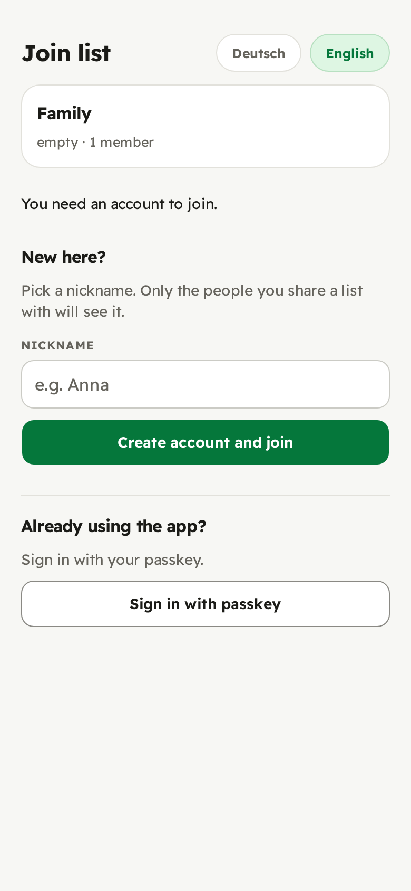
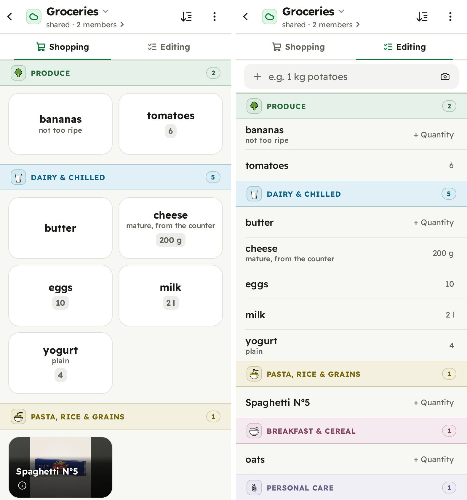
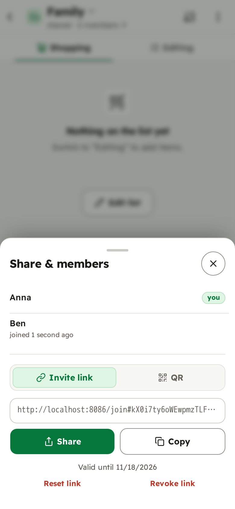

# Using shoppinglist

For everyone on a household's instance. Whoever runs it gives you its address
or, more often, an invite link to a list.

## What you need

A phone or computer with a current browser: an iPhone or iPad with iOS 16.4 or
newer, Android 10 or newer with a current Chrome, or a current Chrome, Edge,
Firefox or Safari on a computer. No email address and no password.

## Getting in

Open the invite link someone sent you. You see the list it is for; pick a
nickname and press **Create account and join**. You are on that list straight away.

Your account is a **passkey**: your phone confirms it's you with your
fingerprint, face or screen lock, the same way it unlocks. There is nothing
to remember. On an iPhone the passkey is kept in iCloud Keychain, on Android in
Google Password Manager, so your other devices on the same account can usually
use it too.

Your nickname is all anyone sees of you, and only the people you share a list
with see it.

Not sure which account you are in? The code at the bottom of *Settings*
(*Account K7Q2*) is the same on every device signed in to that account, and
two accounts with the same nickname have different codes.

## Put it on your home screen

Then it opens in one tap, full screen, like any app, and works without signal.
The app offers this itself; *Settings → Install the app* shows how again.

- **iPhone:** in Safari, tap **Share**, then **Add to Home Screen**, then
  **Add**. Open it from the new icon and sign in there once more.
- **Android:** in Chrome, open the **⋮** menu and choose **Install app** or
  **Add to home screen**.

If the option is missing because you opened the link inside WhatsApp or another
app, open it in Safari or Chrome first.

## Two views of one list

  
   Shopping, in the store: tap a tile to tick it off. Editing, at home: add, change and plan.

**Shopping** is for the store: big tiles in aisle order, and a tap ticks one
off. **Editing** is where you add items and change them. Switch between them at
the top of the list.

- **Adding:** type a few letters and pick a suggestion, which also files the
  item under its aisle. An amount typed with it, as in “2 l milk”, becomes its
  quantity. Things you bought before are one tap away, and the barcode button
  scans a product.
- **Details:** tap an item in Editing for its quantity, a note and its aisle.
- **Undo:** every tick and every removal shows **Undo** for a moment.
- **Previous items:** ticked items stay under the list while you shop, and
  move to *Previous items* three hours after the last tick, ready to put back
  on the list next time.

**Without signal** everything keeps working. Changes that have not reached the
others yet are counted at the top and go out on their own once you are back
online.

## Sharing a list

On the home screen, open a list's **⋮** menu and choose **Share & members**.
Send the invite link, or let someone scan its QR code. Everyone on a list sees
every change within seconds. A link lasts 30 days; **Reset link** replaces it if
it went somewhere it shouldn't, and **Revoke link** ends it without a new one.

## Coming from another app

A list from another app, a note or a chat comes over as text. Share it from
the other app and, on Android with the app installed, pick shoppinglist as the
target. Anywhere else, paste the text into **Import list** on the home screen,
or paste it into a list's add field. Each line
becomes an item and lands in its aisle; an amount such as "1 kg" becomes
its quantity. Before anything is added you see every item, can untick some,
change one the way you would on the list, and choose a new list or one you
already have.

What Die Einkaufsliste, Mealie and Tandoor share or copy comes over with its
sections. A backup from this app goes through **Choose a backup file …** under
**Import list**.

## A new phone, or a lost one

If your passkey is in iCloud Keychain or Google Password Manager, a new phone
signed in to the same Apple or Google account can usually sign in right away.

To be safe, add a second passkey: sign in on another device (a computer can use
your phone's passkey through the QR code the browser offers), then choose
*Settings → Passkeys → Add passkey* there. An account whose only passkey is
lost cannot be recovered. Your lists are not lost with it: ask someone on them
for a new invite and join with a new account.

## Leaving

*Leave list* in a list's **⋮** menu takes you off that list. *Settings →
Permanently delete account* asks for your passkey, then deletes your account and
every list nobody else is on; shared lists stay with their other members. To keep a copy of a list
first, use *Export backup* in its **⋮** menu.
